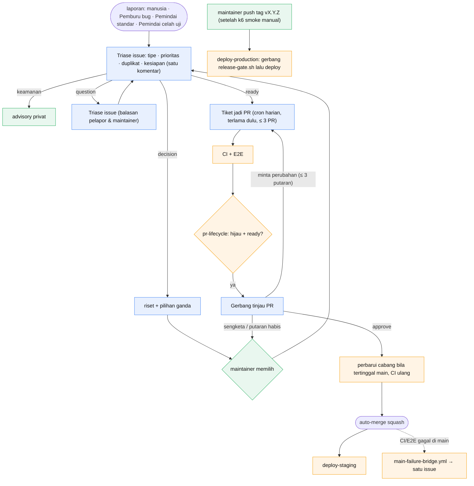
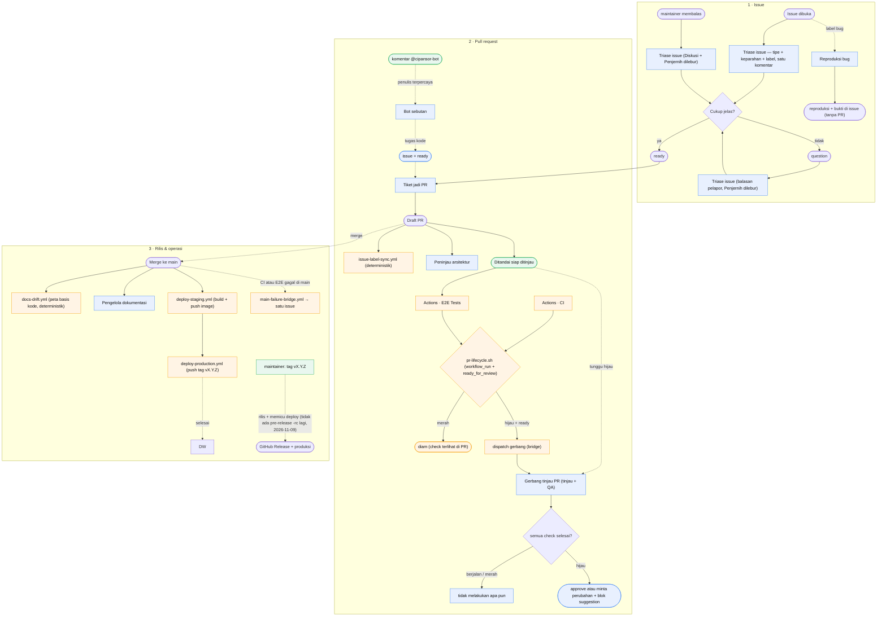
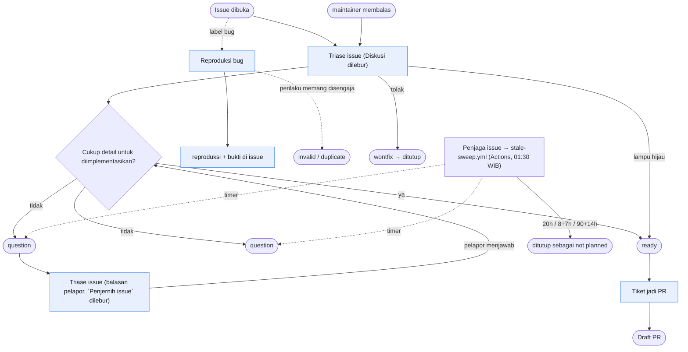
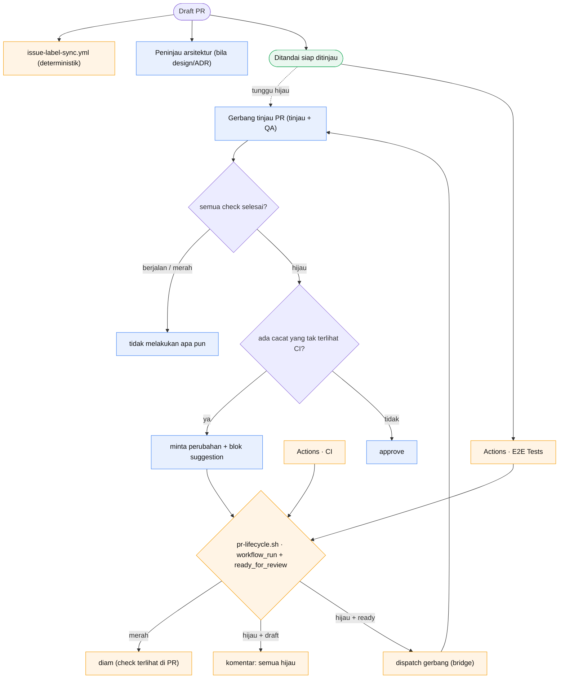
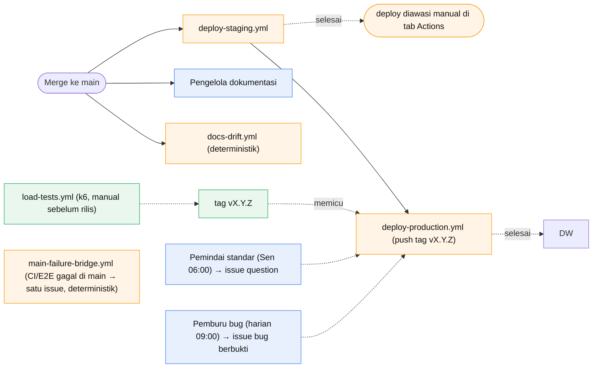
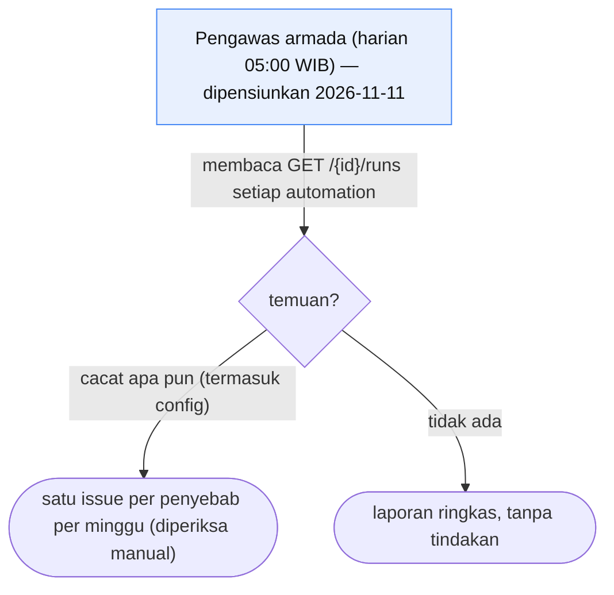

# Alur automation SDLC

Pipeline yang membawa perubahan dari issue yang dilaporkan sampai produksi,
terbagi ke dua jalur yang masing-masing mengerjakan bagian yang paling cocok
untuknya:

- **Automation cloud** (`app.all-hands.dev`) — agen LLM yang membaca konteks dan
  menilai: triase, pelabelan, tinjauan, menulis perbaikan. Ia tidak pernah
  merge, dan menyerahkan keputusan draft/ready kepada manusia atau gerbang
  tinjau.
- **GitHub Actions** — konsekuensi tetap yang harus menyala andal dan tidak
  boleh memakan token: jembatan hasil CI yang men-dispatch gerbang, penyapu
  duplikat, pemeriksaan ketidaksesuaian label, dan deploy. Aturannya ada di
  `.github/scripts/` supaya bisa dijalankan manual.

Jadwal cron cloud dalam **Asia/Jakarta (WIB)**; jadwal GHA dalam **UTC**.
Setiap pemicu komentar membawa guard penulis
`comment.user.login != 'cipansor-bot' && comment.user.type != 'Bot'`, karena
automation memposting lewat akun yang sama dengan pelapor dan tanpa itu akan
memicu dirinya sendiri (insiden #680). Guard-nya penulis komentar, bukan teks
footer: nama akun `cipansor-bot` sudah menandai komentar itu otomatis, jadi
tidak ada footer AI-disclosure yang ditulis (dihapus 2026-10-14). `Bot sebutan`
tidak memakai guard itu; ia memakai `destination: continue_conversation`,
sehingga setiap sebutan tentang satu PR/issue berbagi satu conversation dan
ledakan sebutan tidak menghabiskan kolam sandbox.

**Dua sebutan, dua penanggap.** `@cipansor-bot` membangunkan armada repositori
ini (automation `Bot sebutan` dan kerabatnya). `@openhands` membangunkan
OpenHands GitHub App (`openhands-ai[bot]`), yang membuka conversation OpenHands
Cloud sendiri dan membuka PR. Keduanya dulu menanggapi `@openhands`, sehingga
satu sebutan memicu dua penanggap; dipisah 2026-10-14.

**Satu penulis, satu gerbang.** Hanya `Tiket jadi PR` yang membuka pull request.
Automation lain yang menemukan masalah membuka **issue**, lalu maintainer
menandai issue itu `ready` dan `Tiket jadi PR` yang mengerjakannya. Ini menjaga
satu jalur PR (satu tempat gate, satu bentuk diff) dan membuat penulis PR selalu
`adminypc`.

## Desain target — armada otomatis penuh

Bagian ini adalah **sasaran**, bukan potret keadaan sekarang. **Disetujui
maintainer 2026-10-10**, termasuk keempat pilihan di "Selama publik vs sesudah
privat" dan "Instruksi pelaksanaan". Bagian-bagian
sesudahnya menggambarkan armada apa adanya, dan "Selisih dari keadaan sekarang"
di akhir bagian ini adalah daftar pekerjaannya. Setiap automation, baik cloud
maupun Actions, menyesuaikan diri dengan invarian di bawah. Bila sebuah prompt
atau workflow bertentangan dengan invarian ini, yang dipakai invariannya, dan
pertentangan itu dilaporkan sebagai issue.

### Invarian — berlaku untuk setiap automation

1. **Event dulu, jadwal hanya bila tidak ada event.** Pekerjaan yang dipicu
   sesuatu (issue dibuka, PR hijau, deploy selesai, CI gagal di `main`)
   berjalan pada event itu. Cron hanya untuk pekerjaan yang memang berkala:
   pemburu bug, pemindai standar, pemindai celah uji, audit
   kematangan, dan pengawas armada.
2. **Penilaian oleh agen, konsekuensi pasti oleh Actions.** Apa pun yang harus
   menyala tepat waktu, dapat diuji, dan tidak memakan token (jembatan,
   penyapu, pengawas deploy, pemeriksa label, pembaruan cabang) adalah skrip di
   `.github/scripts/` dengan uji di `apps/api/src/utils/*.guard.test.ts`.
3. **Satu pemilik per langkah.** Hanya satu automation boleh berkomentar
   sebagai pemilik sebuah langkah pada sebuah objek. Triase dan
   label sebuah issue ditulis oleh **satu** automation dalam **satu**
   komentar, yang diperbarui di tempat (bukan ditambah).
4. **Idempoten per kunci.** Setiap tulisan bot membawa penanda
   `<!-- sdlc:<automation>:<kunci> -->`; kuncinya adalah objek ditambah head
   SHA atau id run. Sebelum menulis, automation mencari penandanya. Kalau
   ketemu, ia memperbarui komentar yang ada; kalau tidak, baru menulis. Satu
   masalah, satu issue; satu head, satu review.
5. **Satu penulis PR, satu gerbang.** Hanya `Tiket jadi PR` yang membuka PR,
   dan hanya `Gerbang tinjau PR` yang memberi approve atau minta perubahan.
6. **Batas pekerjaan berjalan (WIP).** `Tiket jadi PR` paling banyak
   memegang **3** PR terbuka sekaligus. Issue `ready` berikutnya menunggu
   antrean, diurutkan menurut prioritas lalu umur.
7. **Saran bot tidak final.** Penulis PR menimbang setiap permintaan gerbang.
   Ia mengikutinya dengan alasan, atau menolaknya dengan alasan dan bukti.
   Sengketa yang tersisa diserahkan ke maintainer sebagai pertanyaan pilihan
   ganda (rekomendasi di urutan pertama). Paling banyak **3 putaran**
   review per PR; sesudah itu PR otomatis menjadi keputusan maintainer.
8. **Keputusan pemilik tidak diambil bot.** Hal yang menjadi wewenang
   yayasan atau maintainer (aturan emas 12) diberi label `decision`. Agen
   menulis riset bersumber, menguji premisnya (termasuk opsi "tidak perlu"),
   lalu menyusun pilihan ganda. Bot tidak pernah memilih.
9. **Rahasia tidak masuk teks publik.** Selama repositori publik, temuan
   keamanan dibuka sebagai **GitHub security advisory privat**, bukan issue.
   Teks publik tidak memuat rahasia, IP, nama sumber daya cloud, atau data
   pribadi (`check-sensitive.py` menolak kasus yang mekanis).
10. **Bukti, bukan klaim.** PR menyertakan perintah yang dijalankan beserta
    keluarannya. Perubahan UI menyertakan tangkapan sebelum/sesudah. Uji
    regresi gagal sebelum perbaikan dan lulus sesudahnya.
11. **Bahasa.** Issue, PR, review, dan komentar ditulis dalam Bahasa Indonesia.
    Judul bagian templat, `Fixes #n`, dan pesan commit tetap seperti
    aturannya.
12. **Pengawas pun diawasi.** Setiap automation meninggalkan jejak run.
    Kegagalan yang **diam** — gerbang yang tidak menjawab, cron yang tidak
    jalan — dideteksi oleh pemeriksa yang tidak bergantung pada automation
    yang diawasinya (pola _dead man's switch_).
13. **Biaya terukur.** Setiap automation punya anggaran token atau menit.
    Laporan pemakaian per automation diperiksa manual setiap minggu, dan
    automation yang melampaui anggarannya berhenti sampai maintainer
    memutuskan.
14. **Mengakui dulu, baru bekerja.** Sebelum menangani apa pun, automation
    menambahkan reaction 👀 pada objek yang ditanganinya (issue, PR, atau
    komentar), supaya orang melihat automation bekerja sebelum jawabannya tiba
    (diminta pengguna 2026-10-13). Pemicu komentar ditangani workflow
    `acknowledge.yml`; automation lain melakukannya dari promptnya.
15. **Issue: komentar dulu, body saat `ready`.** Selama issue belum `ready`,
    triase, kriteria, dan pertanyaan terbuka ditulis sebagai
    **komentar** — percakapan kerja. **Body** issue hanya diperbarui saat bot
    memasang `ready`: ringkasan final ditulis ke body di bawah penanda tetap
    (mis. `<!-- sdlc:triase -->`), diperbarui di tempat. PR berbeda — putusan
    tinjauan dan hasil QA ditulis ke **body** PR di bawah penanda (mis.
    `<!-- sdlc:gerbang -->`), karena PR sudah artefak yang selesai. Setiap body
    dibuka dengan basmalah.
16. **`ready` adalah klaim kuat, dan eksklusif.** `ready` hanya diberikan bila
    automation **sangat yakin**: tujuan jelas, kriteria penerimaan konkret, tanpa
    pertanyaan terbuka. Selama masih ada yang perlu dibahas, diputuskan, atau
    dikritisi, jangan `ready` dulu. `ready` tidak boleh bersama `question` atau
    `blocked` (#814; `blocked` ditambahkan
    2026-11-10 atas keputusan pemilik; `needs-info` dan `pending-maintainer`
    dihapus 2026-11-11 — `question` kini satu-satunya label "masih dibahas").
    `blocked` adalah kontradiksi yang sama:
    issue yang tidak bisa dilanjutkan sampai ketergantungannya selesai bukan
    issue yang bisa diambil kontributor, dan itulah yang dijanjikan `ready`.
    Yang dicabut selalu `ready`, bukan `blocked` — `blocked` membawa informasi
    yang lebih keras, dan mencabutnya akan mengklaim issue itu bisa dimulai lagi.
17. **Hanya `cipansor-bot` yang melabeli.** Label yang dipasang akun lain
    dicabut workflow `label-guard.yml`; tidak ada lagi pengecualian keputusan
    manusia (`bot-implement` dihapus 2026-11-11). Automasi membaca label, jadi
    label manual membuat keduanya berbeda pendapat. `rilis-disetujui`/`rilis-ditolak`
    dihapus 2026-11-09: keduanya tidak pernah ada di repo, dan persetujuan rilis
    kini tag `vX.Y.Z`.
18. **Prioritas berbukti.** Prioritas dinilai dari dampak, urgensi, dan risiko;
    apa pun di atas `medium` WAJIB menyebut bukti konkret, tanpa bukti maksimum
    `medium`, dan bila ragu pilih yang lebih rendah. `critical` hanya untuk
    layanan mati total, kehilangan/korupsi data, atau masalah keamanan/privacy
    yang aktif bisa dieksploitasi. Jangan menginflasi `critical`.
19. **Triase ulang dipicu setelah automation lain menanggapi.** Tak satu pun
    automation memicu `issues.edited`. Sebuah jembatan deterministik
    (`issue-triage-bridge.yml` + `.github/scripts/issue-triage-bridge.sh`)
    mendispatch pemilik triase saat bot memasang label tipe/prioritas, dan saat
    **sinyal aktivitas** sebuah issue belum `ready` berubah sejak checkpoint
    terakhir jembatan. Sinyalnya adalah hash dari body issue plus setiap
    komentar **bukan-armada** (penulis + `updated_at` + body) — jadi suntingan
    deskripsi, komentar baru, atau komentar yang disunting semuanya mengubah
    sinyal. Karena sinyalnya isi, bukan timestamp beresolusi detik, suntingan
    pelapor pada detik yang sama dengan tulisan checkpoint tetap tertangkap
    (perbandingan `<=`-detik lama menelannya). Komentar armada sendiri (bot dan
    GitHub Actions) tidak dihitung, sehingga balasan bot tak pernah memicu
    triase ulang dirinya — itu yang menutup loop. Idempoten: satu putaran = satu
    dispatch (checkpoint per keadaan tipe+prioritas dalam jendela burst 300 dtk,
    dan satu checkpoint sweep per issue). Checkpoint disimpan di **KV store
    otomasi**, bukan di komentar: penanda yang hanya berisi HTML tampil sebagai
    komentar **kosong**, memberi notifikasi ke setiap pelanggan issue dan
    meninggalkan cangkang tak terbaca (2026-11-11: 153 penanda). Jembatan tidak
    menulis komentar di jalur mana pun; penanda lama diadopsi ke store sekali
    lalu dihapus. Checkpoint ditulis setelah dispatch diterima (HTTP 2xx), jadi
    dispatch yang gagal diulang sweep berikutnya dan run-nya gagal keras. Issue
    lama yang ringkasannya ada di body tanpa checkpoint (ditriase sebelum
    jembatan ini ada) tetap disapu sekali, bukan dilewati selamanya. Sapuan
    memproses setiap kandidat tanpa membiarkan satu issue yang tak perlu
    dispatch menghentikannya, dan membaca sampai `SWEEP_PAGES` halaman (urut
    aktivitas terbaru) sementara `SWEEP_MAX` membatasi jumlah dispatch per run.
20. **Dinding jam setiap automation adalah 1800 detik — platform tidak
    menerima lebih.** Sebuah run yang melewati `timeout`-nya mati sebagai
    `execution/timeout`, bukan karena tugasnya salah. Batas itu bukan pilihan
    gaya: API menolak `timeout` di atas **1800** dengan
    `422 timeout must not exceed 1800 seconds` (terverifikasi 2026-10-18).
    Karena itu **setiap** automation diset tepat `1800`, bukan angka yang lebih
    kecil: yang lebih kecil tidak menghemat apa pun dan hanya memindahkan
    kematian ke run yang tugasnya jujur (lima automation pernah dijeda otomatis
    platform setelah lima `execution/timeout` beruntun — `Triase bug` dan
    `Triase issue` dengan `timeout=900` mati 50/16 kali). Pemeriksa manual memeriksa satu hal ini:
    setiap automation ber-`timeout` < 1800 adalah cacat `config` yang
    dilaporkan, dan `scripts/deploy-sdlc-agents.py` menegakkan angka itu saat
    prompt di-deploy. Plafon hanya membatasi **kapan** sebuah run dibunuh,
    bukan **kapan ia berhenti**: sebuah tugas yang menjelajah tanpa batas tetap
    mati di dinding (2026-10-18: `Pengawas armada` — kini dipensiunkan — mati 1800 detik delapan run
    beruntun, tanpa satu pun laporan), jadi setiap automation semacam itu juga
    membawa anggaran kerja sendiri. Kegagalan yang **bukan** dinding jam tetap
    ditangani seperti biasa: `environment_unavailable` (burst dispatch) oleh
    antrean `MAX_INFLIGHT` di `issue-triage-bridge.sh`. Retry infra otomatis
    (`automation-retry.yml`) dihapus 2026-11-11: run yang mati infra dijalankan
    ulang manual dari OpenHands Cloud.
21. **Deskripsi PR tidak ditanggapi otomatis.** Tidak ada pemicu
    `pull_request.edited`; gerbang tinjau yang sudah ada membaca deskripsi PR,
    issue tertaut, seluruh diff, dan semua komentar. Sebuah pemicu edit akan
    bertabrakan dengan `basmalah.yml` yang mem-PATCH body sebagai
    `github-actions[bot]`.

### Alur ujung ke ujung



| #   | Tahap        | Pemicu                                                                                                                              | Pemilik                                           | Keluaran                                                                                                                                                                                                           | Lanjut bila                                                                                 |
| --- | ------------ | ----------------------------------------------------------------------------------------------------------------------------------- | ------------------------------------------------- | ------------------------------------------------------------------------------------------------------------------------------------------------------------------------------------------------------------------ | ------------------------------------------------------------------------------------------- |
| 1   | Laporan      | manusia, atau temuan automation berkala                                                                                             | pelapor                                           | issue sesuai templat; temuan keamanan → advisory privat                                                                                                                                                            | issue terbuka                                                                               |
| 2   | Triase       | `issues.opened`                                                                                                                     | `Triase issue`                                    | belum final → **satu komentar** (tipe, prioritas berbukti, duplikat, kesiapan); final (`ready`) → ringkasan di **body** issue, tanpa komentar | label `ready` / `question` / `decision` / `duplicate`                                       |
| 3   | Klarifikasi  | balasan pada issue `question`, label bot, atau aktivitas baru (jembatan triase)                                                     | `Triase issue` (balasan pelapor **dan** maintainer; `Penjernih issue` + `Diskusi` dilebur) | komentar penilaian ulang; body issue diperbarui hanya saat `ready`                                                                                                                                                 | `ready`                                                                                     |
| 4   | Keputusan    | label `decision`                                                                                                                    | agen riset → maintainer                           | riset bersumber + pilihan ganda; maintainer memilih                                                                                                                                                                | keputusan tercatat di `.claude/memory/decisions/`, lalu `ready`                             |
| 5   | Implementasi | cron harian `Tiket jadi PR`: memindai antrean `ready` **terlama dulu**, membuka ≤ 3 PR per run                                      | `Tiket jadi PR`                                   | PR draf dengan templat, uji, bukti, `Fixes #n`                                                                                                                                                                     | daftar periksa penulis lengkap → ready for review                                           |
| 6   | CI           | push                                                                                                                                | Actions                                           | Build, Lint, Tests, Security, E2E                                                                                                                                                                                  | semua hijau                                                                                 |
| 7   | Tinjauan     | `pr-lifecycle.sh` (hijau + ready; `workflow_run` atau `ready_for_review`), otomatis untuk **setiap head hijau yang belum ditinjau** | `Gerbang tinjau PR`                               | satu review per head, dengan blok `suggestion`; payload kosong → gerbang memilih sendiri satu PR yang `requested_reviewers` memuat `cipansor-bot` dan head-nya belum ditinjau, tiebreak **head paling baru hijau** | approve                                                                                     |
| 8   | Perbaikan    | review minta perubahan                                                                                                              | `Tiket jadi PR`                                   | ikuti atau tolak dengan alasan; ≤ 3 putaran                                                                                                                                                                        | head baru hijau → tahap 7 otomatis (gerbang meninjau setiap head hijau yang belum ditinjau) |
| 9   | Merge        | approve + check hijau + cabang mutakhir                                                                                             | Actions (auto-merge)                              | squash ke `main`                                                                                                                                                                                                   | —                                                                                           |
| 10  | Staging      | E2E hijau di `main`                                                                                                                 | `deploy-staging`                                  | staging menyajikan SHA itu                                                                                                                                                                                         | —                                                                                           |
| 11  | Calon rilis  | manual: k6 smoke dijalankan terhadap staging, lalu tag `vX.Y.Z` di-push                                                             | maintainer                                        | tag rilis pada commit yang sudah diverifikasi staging                                                                                                                                                              | tag ter-push                                                                                |
| 12  | Produksi     | push tag `vX.Y.Z`                                                                                                                   | `deploy-production` (gerbang `release-gate.sh`)   | produksi menyajikan SHA itu; langkah data pasca-rilis masing-masing dengan persetujuan                                                                                                                             | —                                                                                           |
| 13  | Operasi      | CI/E2E gagal di `main`; Health check / availability test                                                                            | `main-failure-bridge.yml`; platform                | satu issue per workflow (deterministik, tanpa LLM)                                                                                                                                                                 | —                                                                                           |
| 14  | Pengawasan   | manual                                                                                                                              | OpenHands Cloud (riwayat run) + pemeriksa Actions | kesehatan, pemakaian, kegagalan diam                                                                                                                                                                               | —                                                                                           |

### Gerbang manusia — hanya empat

1. **Keputusan pemilik** (tahap 4): bot tidak pernah memilih.
2. **Rilis produksi** (tahap 12): setiap rilis meminta persetujuan baru.
3. **Tindakan merusak atau menulis data produksi**: loader data, reset sandi
   massal, migrasi yang menghapus. Masing-masing disetujui sendiri, termasuk
   bila tercantum di daftar periksa rilis.
4. **Sengketa saran bot** (invarian 7): bila penulis dan gerbang tidak
   sepakat, atau putaran review habis.

Di luar keempat titik itu, alur berjalan tanpa menunggu manusia.

### Selama publik vs sesudah privat

Dua fitur GitHub yang paling cocok di sini hanya tersedia untuk repositori
publik pada paket Team. Desainnya memakai mekanisme yang tetap berjalan sesudah
repositori privat:

| Kebutuhan                                      | Selama publik                                      | Sesudah privat (Team) | Dipakai di sini                                                                                                                                                                                                                                                           |
| ---------------------------------------------- | -------------------------------------------------- | --------------------- | ------------------------------------------------------------------------------------------------------------------------------------------------------------------------------------------------------------------------------------------------------------------------- |
| Persetujuan rilis produksi                     | _required reviewers_ pada environment `production` | tidak tersedia        | **tag `vX.Y.Z`** (dipush maintainer) — memicu `deploy-production.yml`; environment `production` tetap menjadi gerbang identitas OIDC-nya. Lebih ringkas daripada label pada issue: satu artefak yang sama menyatakan rilis **dan** memicunya. Bisa dipakai di kedua fase. |
| Uji gabungan PR yang bertumpuk (aturan emas 9) | _merge queue_                                      | tidak tersedia        | **ruleset `strict` (cabang harus mutakhir)** + job Actions yang memperbarui cabang PR ber-auto-merge saat `main` bergerak. Bisa dipakai di kedua fase.                                                                                                                    |
| Kuota menit Actions                            | gratis                                             | 3.000 menit/bulan     | event dulu (invarian 1); laporan pemakaian mingguan (invarian 13)                                                                                                                                                                                                         |

### Kegagalan dan penanganannya

| Kegagalan                                                                                                                   | Deteksi                                                               | Tindakan                                                                                                                                                                                             |
| --------------------------------------------------------------------------------------------------------------------------- | --------------------------------------------------------------------- | ---------------------------------------------------------------------------------------------------------------------------------------------------------------------------------------------------- |
| CI/E2E merah di `main`                                                                                                      | `main-failure-bridge.yml`                                             | satu issue per workflow (deterministik); maintainer membaca penyebab dari run page                                                                                                                   |
| Gerbang tinjau tidak menjawab, atau run automation mati infrastruktur (timeout, sandbox tidak tersedia, 502, proxy LLM 503) | **manual**: riwayat run di OpenHands Cloud, tab Actions untuk gerbang | jalankan ulang run yang gagal dari OpenHands Cloud. Deteksi otomatis (`gate-watch.yml`, `automation-retry.yml`) dihapus 2026-11-11 atas keputusan pemilik — tab Actions dan email GitHub sudah cukup |
| Deploy gagal, macet, atau commit salah                                                                                      | **manual**: tab Actions `Deploy staging` / `Deploy production`        | jalankan ulang atau perbaiki; email notifikasi GitHub sudah ada. `deploy-watch.yml` dihapus 2026-11-11 (pemilik mengawasi langsung)                                                                  |
| Situs menurun tanpa deploy                                                                                                  | Health check App Service + availability test                          | alert dari platform                                                                                                                                                                                  |
| Anggaran terlampaui                                                                                                         | laporan pemakaian                                                     | automation berhenti; maintainer memutuskan                                                                                                                                                           |
| Bot memicu dirinya sendiri                                                                                                  | guard penulis komentar pada setiap pemicu komentar                    | — (pencegahan)                                                                                                                                                                                       |

### Selisih dari keadaan sekarang

Daftar ini yang perlu disesuaikan. Setiap butir menjadi issue tersendiri;
Pemeriksa manual menandai butir yang sudah selesai.

1. **Triase ganda — SELESAI (2026-11-09).** Issue baru dulu mendapat dua
   sampai tiga komentar triase dari automation berbeda. Kini hanya satu
   pemilik: `Estimasi usaha` (SDLC 02) dan `Triase bug` (SDLC 01) sama-sama
   dilebur ke `Triase issue` (SDLC 15), yang menulis satu komentar berisi
   tipe, prioritas (berbukti), keparahan dan sebab, area, kesiapan, dan
   duplikat. Langkah estimasi usaha dihapus 2026-11-11 — pekerjaannya
   dikerjakan AI, jadi ukuran XS–XL dan kalibrasi hanya menambah baris yang
   dibaca tanpa mengubah keputusan. Kedua automation lama dinonaktifkan;
   jembatan triase (`issue-triage-bridge.sh`) kini mengarah ke SDLC 15. Ini
   menutup #848 (invarian 3–4).
2. **Gerbang tinjau diam.** Gerbang pernah tidak menjawab sebelas jam tanpa
   ada yang tahu, lalu sehari penuh pada lima PR (2026-10-10). Pemeriksa
   Actions-nya dulu `gate-watch.yml` (#776, dihapus 2026-11-11); butir ini selesai begitu PR-nya
   masuk. Retry-nya kini terukur: run gerbang yang mati infrastruktur,
   tercatat hilang dari riwayat, atau selesai tanpa menulis review di-dispatch
   ulang sampai 3 kali per head, dan hanya selama run yang di-dispatch untuk
   head itu tidak sedang berjalan. Skrip mencatat run id yang ia dispatch di
   penanda komentar head itu dan membaca status id itu kembali dari listing
   run (ditelusuri `limit`/`offset` sampai id ditemukan, jadi run yang
   tergeser ke halaman berikutnya tidak salah disebut hilang) — API runs tidak
   punya endpoint per-run id, dan tanpa pencatatan ini run terbaru milik PR
   lain bisa salah menahan atau salah memicu retry.
3. **Cron yang bertentangan dengan keputusan — selesai 2026-11-09.** `Penjaga
issue` dan `Uji beban` dimatikan; k6 berjalan lewat `load-tests.yml` sebelum
   rilis. Penutupan berdasarkan umur **dihidupkan kembali sebagai GitHub Action**
   (`.github/workflows/stale-sweep.yml` + `.github/scripts/stale-sweep.sh`),
   timer sama: `question` 8+7, lain-lain 90+14. Ia
   deterministik, jadi tidak memakai sandbox — akar masalah automation LLM yang
   mati lima kali beruntun lalu dijeda platform.
4. **Persetujuan rilis — selesai 2026-11-09.** Rilis kini tag `vX.Y.Z` yang
   dipush maintainer, bukan label pada issue: tidak ada label `rilis-disetujui`
   yang pernah ada di repo, dan tag memicu deploy sekaligus menyatakan
   persetujuannya.
5. **Temuan keamanan.** Kini ditulis netral di issue publik. Pindahkan ke
   advisory privat.
6. **Aturan emas 9.** Kini manual. Nyalakan ruleset `strict` dan job
   pembaruan cabang.
7. **WIP dan batas putaran.** Belum ada. Tambahkan pada `Tiket jadi PR` dan
   `Gerbang tinjau PR`.
8. **Laporan pemakaian.** Belum ada. Diperiksa manual di OpenHands Cloud.
9. **Dinding jam seragam, dan anggaran kerja untuk yang panjang.** Lima
   automation pernah dijeda otomatis platform (lima `execution/timeout`
   beruntun): `Triase bug` dan `Triase issue` diset `timeout=900`, `Pengawas armada` (dipensiunkan) `1500`, padahal
   tugasnya ~1000–2000 detik dan platform menerima sampai **1800**. Selesai
   2026-10-18: seluruh armada diset `1800`, dan
   `scripts/deploy-sdlc-agents.py` menegakkan angka itu saat prompt di-deploy
   (invarian 20). **Menaikkan plafon saja tidak cukup** untuk tugas yang
   menjelajah tanpa batas: `Pengawas armada` (dipensiunkan 2026-11-11) tetap mati 1800 detik setelahnya,
   delapan run beruntun tanpa satu pun laporan terkirim, karena membaca riwayat
   run setiap automation satu per satu memakan seluruh anggaran. Ia kini membawa
   **anggaran kerja** sendiri (daftar sekali, tiap automation satu bacaan,
   berhenti mengumpulkan pada ~20 panggilan API dan menulis laporan dari yang
   ada) — pola yang sama dengan `Gerbang tinjau PR`.

   **Diperluas ke seluruh armada 2026-10-20.** Dinding jam adalah kegagalan
   armada yang dominan, dan ia bukan tugas yang salah: 128 dari 253 run FAILED
   mati pada ≥1780 detik dengan `current_phase` "Agent is working on the task" —
   agen masih bekerja ketika plafon menabraknya. Bukti bahwa anggaran kerjanya
   yang bekerja, bukan plafonnya: `Gerbang tinjau PR` membawa anggaran dan
   mencatat **0** kematian dinding setelahnya, sedangkan `Triase bug` tidak
   membawa dan mencatat **23** pada jendela yang sama. Karena plafon tidak bisa
   dinaikkan, `scripts/deploy-sdlc-agents.py` kini menyisipkan satu anggaran
   jam pasir (`ANGGARAN WAKTU — JAM PASIR`) ke **setiap** prompt yang belum
   membawa anggaran sendiri (10/25/35 perintah, berhenti dan kirim hasil).
   `conversation_id` **bukan** penanda sandbox dan tidak boleh dipakai untuk
   mengklasifikasi kegagalan: ia null pada hampir setiap run yang mati di
   dinding (234 dari 253 run FAILED tetap punya `sandbox_id`). Klasifikasi
   `Pengawas armada` (dipensiunkan) memakai `error_detail` + **tenggat run itu sendiri**
   (`completed_at >= timeout_at`), bukan ambang durasi tetap: riwayat memuat era
   `timeout=900` yang matinya ~1000 detik, dan ambang 1780 detik salah
   mengkelaskannya. Dua koreksi lain pada `Pengawas armada` (2026-10-20, sejak itu dipensiunkan):
   endpoint-nya adalah **akar API** (`GET /api/automation/v1`, `GET
/api/automation/v1/{id}/runs?limit=5`) seperti
   `.github/scripts/automation-retry.sh` (dihapus 2026-11-11) — `/automations` menjawab `422` dan
   `/automations/{id}/runs` menjawab `404`, jadi watchdog yang memakai bentuk
   itu tidak membaca apa pun; dan riwayat run diperiksa **berotasi**
   (`start = hari-ke-%j % jumlah automation`, melingkar) karena daftar
   automation lebih panjang daripada anggaran ~19 bacaan run — tanpa rotasi ekor daftar
   tak pernah diperiksa. Konfigurasi seluruh daftar (enabled, timeout, guard,
   tabrakan cron) tetap disapu penuh setiap hari tanpa satu pun panggilan run.
   **Kelas kelima (`wall-short`).** Sebuah run ber-`error_detail` "command
   timed out or was killed" yang mati **sebelum** tenggatnya sendiri
   (`completed_at < timeout_at`) bukan `wall`: run-nya tidak menabrak plafon,
   perintahnya yang menggantung (atau tenggat run berubah di tengah jalan).
   `wall-short` dilaporkan terpisah, karena saran `wall` — menambah anggaran —
   justru salah untuk satu perintah yang menggantung. Dengan kelas ini setiap
   run "command timed out" punya kelas; tak ada yang jatuh tanpa kelas.
   **Prompt terpotong ditolak, bukan ditambal.** Sebuah prompt tanpa penanda
   `PERILAKU SASARAN` telah kehilangan ekornya. Untuk automation ber-ekor
   terkelola (`TAILS`) kerugiannya tak berbahaya — ekornya (instruksi tugas)
   dipasang ulang dari skrip, jadi automation itu dibangun utuh. Untuk yang
   **tanpa** ekor terkelola, ekor itu adalah instruksi tugasnya sendiri dan
   hilang: menempelkan anggaran ke kepala yang tersisa hanya mengirim prompt
   yang tak bisa menjalankan tugasnya. Karena itu `new_prompt` **menolak**
   (`TruncatedPromptError`) alih-alih mengirimnya, dan menyebut satu-satunya
   basis yang memulihkannya — `ORIGINALS=<json>` (prompt asli sebelum
   terpotong). Satu automation yang ditolak tidak menghentikan deploy 23
   lainnya; skrip keluar dengan kode 2 dan mencetak daftar yang ditolak.
   **Perbaikan config tetap ditegakkan walau prompt ditolak:** `timeout` (dinding
   jam 1800 detik) dan guard trigger tidak bergantung pada isi prompt, jadi
   keduanya diterapkan lebih dulu — automation yang promptnya ditolak tetap
   dinaikkan ke `timeout=1800`, hanya prompt-nya yang ditahan.

### Instruksi pelaksanaan

Untuk setiap automation, terutama OpenHands: **ikuti bagian ini.** Bila
prompt atau jadwal sebuah automation berbeda dari desain target, yang benar
adalah desain target. Ubah automation-nya, bukan dokumen ini. Dokumen ini
hanya berubah lewat PR yang disetujui maintainer.

**Rilis produksi, langkah demi langkah** (keputusan 2026-10-10; pemicu tag
2026-11-09):

1. Maintainer memutuskan kapan rilis. Tidak ada lagi kandidat mingguan:
   `Pembuat catatan rilis` (SDLC 13) dipensiunkan karena tag `-rc`-nya tidak
   dikonsumsi apa pun dan nomornya berhenti menandai kode terverifikasi.
2. Ia menjalankan k6 smoke terhadap staging untuk SHA yang akan dirilis
   (`load-tests.yml`, Actions → Run workflow). Ini prasyarat, bukan formalitas:
   gerbang menolak rilis tanpa run k6 hijau pada SHA itu. Target run itu
   (`url`) harus staging — input `url` bebas, jadi run hijau terhadap host lain
   tidak membuktikan staging diuji; gerbang membaca judul run (`run-name`) dan
   memastikannya menyebut staging.
3. Ia menulis catatan rilis di body Release dan memotong tag **resmi**:

   > ```
   > git tag v0.2.0 <sha>
   > git push origin v0.2.0
   > ```

   Tag wajib berbentuk `vX.Y.Z` — tanpa `-rc`, tanpa sufiks. Tag itu adalah
   pernyataan "commit ini, sudah diverifikasi staging, adalah rilis", sekaligus
   yang memicu deploy. Tidak ada berkas CHANGELOG di repositori.

4. Push tag memicu `deploy-production.yml`. Job pertamanya, `gate`, memeriksa
   fakta secara mekanis (`.github/scripts/release-gate.sh`): pendorong tag
   ber-permission admin (akses tulis saja cukup untuk mendorong tag `v*`),
   tag berbentuk `vX.Y.Z` dan tidak bersufiks, commit tag ada di `main`, SHA 40
   heksadesimal, staging **sedang menyajikan** SHA itu, dan ada run
   `load-tests.yml` hijau untuk SHA itu **yang targetnya staging**. Job `deploy` menunggu gerbang
   (`needs: gate`), jadi rilis yang faktanya belum lengkap tidak bisa lewat —
   termasuk rilis yang melewatkan k6, atau yang k6-nya dijalankan ke host lain.
   Gerbang **tidak** memutuskan apakah rilis harus terjadi; itu keputusan
   maintainer di langkah 1–3.
5. `deploy` mengambil cadangan, menjalankan pra-cek migrasi, men-deploy, dan
   menunggu `/healthz` produksi menyajikan SHA itu. Dulu `deploy-watch.yml` membuka
   issue bila ada yang gagal. Tidak ada rollback otomatis.
6. Langkah data pasca-rilis (loader, reset sandi massal) **tidak** ikut
   otomatis. Masing-masing menunggu persetujuannya sendiri (gerbang manusia 3).
7. **Rollback** — `workflow_dispatch` dipertahankan **hanya** untuk ini:
   dispatch `deploy-production.yml` dengan SHA rilis sebelumnya. Gerbang berjalan
   dalam mode `rollback`, yang melewatkan cek staging dan k6 dengan sengaja:
   target rollback menurut definisinya adalah commit yang sudah tidak disajikan
   staging. Dua syarat tetap ada: SHA itu harus commit yang pernah ada di
   `main`, supaya dispatch tidak bisa mengarahkan produksi ke kode yang tak
   pernah disetujui rilis mana pun, dan pelakunya harus ber-permission admin —
   sama seperti jalur tag, sebab `workflow_dispatch` hanya menuntut akses tulis,
   dan rollback mengubah apa yang dijalankan produksi. `deploy` juga tetap
   menolak SHA yang image-nya tak pernah dibangun.
   Migrasi bersifat maju-saja; rollback yang mengubah skema dipulihkan dari
   cadangan langkah 5.

**Urutan pekerjaan** (satu issue per butir, lalu PR sesuai templat; tiap
butir mengikuti aturan emas di `AGENTS.md`):

1. ~~**Maintainer** mematikan cron cloud `Penjaga issue` dan `Uji beban` di
   `app.all-hands.dev`.~~ **SELESAI 2026-11-09**: keduanya sudah nonaktif —
   `Penjaga issue` (SDLC 21) diport ke `stale-sweep.yml`, `Uji beban` (SDLC 11)
   pindah ke `load-tests.yml`.
2. **Pengawas gerbang tinjau** — **dihapus 2026-11-11**. PR yang gerbangnya diam
   diperiksa manual dari riwayat run OpenHands Cloud, dan dispatch ulang
   dijalankan dari sana.
3. **Triase satu pemilik** — SELESAI (2026-11-09): hanya `Triase issue` yang
   menulis triase dan label, dalam satu komentar yang diperbarui (estimasi
   usaha dihapus 2026-11-11).
   `Estimasi usaha` (SDLC 02) dan `Triase bug` (SDLC 01) sama-sama dilebur ke
   sini; kedua automation lamanya dinonaktifkan. Balasan pelapor pada issue
   `question` juga kini ditangani `Triase issue`: `Penjernih issue` (SDLC 16)
   dipensiunkan 2026-11-12 (opsi (a) dari #1056) karena jembatan triase sudah
   menyapu issue `question`, sehingga satu balasan pelapor membangunkan dua agen
   — cacat yang sama dengan yang memensiunkan `Diskusi`. Jembatan triase
   mengarah ke SDLC 15.
4. **Pembaruan cabang otomatis** (Actions): saat `main` bergerak, cabang PR
   yang ber-auto-merge dan tertinggal diperbarui lewat API, sehingga CI
   berjalan ulang di atas `main` terbaru. **Sesudah** job ini ada di `main`,
   ruleset `main` dinyalakan `strict` (cabang harus mutakhir). Mengubah
   ruleset adalah tindakan admin; maintainer melakukannya atau mengizinkannya.
5. **Rilis lewat tag** — SELESAI (2026-11-09): rilis adalah tag `vX.Y.Z` yang
   dipush maintainer, bukan label pada issue rilis mingguan. `deploy-production.yml`
   dan `docs/deploy-azure.md` → "How a change is released" sudah ditulis ulang
   sesuai alur itu. Dua prasyarat lingkungan yang hanya bisa diubah maintainer
   (admin) dan **wajib ada sebelum rilis tag pertama**, karena tanpa keduanya
   deploy produksi tidak akan berjalan:
   a. environment `production` di repo hanya mengizinkan ref `main`
   (`deployment-branch-policies`), sedangkan deploy kini dipicu tag `v*`.
   Tambahkan pola tag `v*` ke kebijakan cabang environment itu, atau rilis
   pertama akan tertahan di job `deploy` (butuh persetujuan environment).
   b. belum ada baseline k6 tersimpan (`tests/load/baselines/` tidak ada), jadi
   run `load-tests.yml` keluar dengan kode `3` ("no baseline recorded") dan
   **tidak pernah hijau**. Rekam baseline staging dari GitHub runner
   (`load-tests.yml`, centang _record_baseline_) lalu commit artefaknya
   lewat PR — kalau tidak, gerbang rilis menolak setiap rilis.
6. **Temuan keamanan ke advisory privat**: _private vulnerability reporting_
   menyala, `SECURITY.md` menjelaskan cara melapor, dan `Pemburu bug`,
   `Pemindai standar`, serta `Pemindai celah uji` membuka draf advisory, bukan
   issue, untuk temuan keamanan.
7. **WIP ≤ 3 dan ≤ 3 putaran review** pada `Tiket jadi PR` dan
   `Gerbang tinjau PR`.
8. **Laporan pemakaian mingguan** (manual, OpenHands Cloud): menit Actions dan
   token per automation, dibanding anggarannya.

**Setiap kali membuat atau mengubah automation yang dipicu komentar**
(`issue_comment.created`), sebelum menyalakannya: pastikan filternya memuat
`comment.user.login != 'cipansor-bot' && comment.user.type != 'Bot'`, lalu
uji dengan satu komentar contoh dari `cipansor-bot` (tanpa footer). Komentar itu
**tidak boleh** memicunya. Ini satu-satunya titik yang mencegah loop #680.
Pemeriksaan berkala datang sesudah anggarannya habis, jadi tidak dipasang
(`.claude/memory/decisions/otomasi-armada.md` butir 8).

## Menyeluruh



## Siklus hidup issue



## Siklus hidup pull request — gerbang CI



**Pintu masuk — PR lahir dari issue `ready`.** Sebelum membuka PR, cari issue
terbuka yang diselesaikannya; bila belum ada, buka lewat formulir
`.github/ISSUE_TEMPLATE/` dan tunggu `Triase issue` memasang `ready`. **Menolak
membuka PR tanpa issue `ready` adalah jawaban yang benar**, bukan celah untuk
dilewati: `pr-template-guard.sh` merah sampai ada issue terbuka berlabel
`ready`, dan menautkan nomor yang ternyata PR atau issue tertutup tetap gagal.
Prosedur lengkapnya ada di skill `buat-pr` (`.claude/skills/buat-pr/SKILL.md`),
yang juga memuat isian templat PR dan aturan `Fixes #<n>`.

## Rilis & operasi



## Pengawasan armada



## Armada terjadwal (cron cloud, WIB)

| Waktu        | Automation         | Tugas                                                                                       |
| ------------ | ------------------ | ------------------------------------------------------------------------------------------- |
| (manual)     | OpenHands Cloud    | kesehatan semua automation                                                                  |
| 09:00 harian | Pemburu bug        | bug terbukti → satu issue berbukti                                                          |
| 06:00 Senin  | Pemindai standar   | penyimpangan standar → `question`                                                           |
| 08:00 harian | Tiket jadi PR      | antrean `ready` terlama dulu → ≤ 3 PR (kuota sandbox pulih 07:00)                           |
| 08:15 Senin  | Pemindai celah uji | satu celah uji berisiko → issue                                                             |
| (tidak ada)  | —                  | rilis kini peristiwa manual: tag `vX.Y.Z` (`Pembuat catatan rilis` dipensiunkan 2026-11-09) |
| (manual)     | Audit kematangan   | menilai 18 item → satu issue; dinonaktifkan 2026-11-10, dinilai manual dari OpenHands Cloud |

Actions terjadwal: `duplicate-detect` (harian 01:15 UTC = 08:15 WIB, dan saat
`issues.opened`: dua issue **terbuka** berjudul sama setelah dinormalkan →
yang lebih baru dilabeli `duplicate` dan ditautkan ke yang lebih awal;
pendeteksi tidak menutup apa pun, dan pasangan yang aslinya sudah tertutup
bukan duplikat; label yang dicabut **cipansor-bot** tidak dipasang ulang,
sedangkan pencabutan oleh aktor lain — manusia, `github-actions[bot]`,
otomasi lain — bisa dipasang ulang pada sapuan berikutnya), `duplicate-sweep`
(harian 01:30 UTC = 08:30 WIB,
menutup issue `duplicate` 7 hari setelah peringatan — PR hanya dilabeli
`duplicate-pr` sebagai kandidat, tidak pernah ditutup), `stale-sweep`
(harian 18:30 UTC = 01:30 WIB, port deterministik `Penjaga issue`:
`question`/lain-lain menua lalu ditutup), dan `docs-drift`
(harian 21:41 UTC, menyegarkan badan issue induk #782). Dua pengawas
(`gate-watch`, `automation-retry`) dan `deploy-watch.yml` dihapus 2026-11-11:
pemilik mengawasi langsung dari OpenHands Cloud dan tab Actions, dengan email
notifikasi GitHub sebagai kanal peringatan. Manual: `load-tests.yml` (k6 vs staging), langkah wajib sebelum tiap
rilis produksi (`docs/deploy-azure.md` → "How a change is released").
Catatan rilis ditulis maintainer di body Release saat memotong tag; tidak ada
berkas CHANGELOG di repositori, dan tidak ada lagi automation yang memotong
kandidat mingguan.

Yang **sengaja tidak ada** (diputuskan 2026-10-10, direvisi 2026-11-09): tidak
ada uji beban terjadwal — tanpa lalu lintas nyata, run berkala mengukur staging
yang sama-sama sepi; tidak ada pantauan metrik terjadwal sebelum ada pengguna
nyata. Penutupan issue berdasarkan umur dulu termasuk daftar ini, tetapi
**dihidupkan kembali 2026-11-09 sebagai GitHub Action deterministik**
(`stale-sweep.yml`), bukan automation LLM: keputusannya label + stempel waktu,
dan bentuk lamanya (sandbox 1800 detik untuk itu) justru yang menjeda armada.
Timer dan pengecualiannya sama seperti `Penjaga issue` dulu.

## Peran — siapa berbuat sebagai siapa

| Automation            | Peran                                                                                                                                                                                                                                                                                                                                                                                                                                                                             |
| --------------------- | --------------------------------------------------------------------------------------------------------------------------------------------------------------------------------------------------------------------------------------------------------------------------------------------------------------------------------------------------------------------------------------------------------------------------------------------------------------------------------- |
| (deterministik)       | `docs-drift.yml` — `collect_facts.py` + `check_docs.py` menyegarkan **badan issue induk #782** (angka, Lampiran A); menggantikan `Peta basis kode`                                                                                                                                                                                                                                                                                                                                |
| Peninjau arsitektur   | meninjau dokumen desain/RFC/ADR                                                                                                                                                                                                                                                                                                                                                                                                                                                   |
| Reproduksi bug        | menyelidiki issue `bug`, menempel reproduksi + bukti ke issue                                                                                                                                                                                                                                                                                                                                                                                                                     |
| Tiket jadi PR         | **satu-satunya pembuat PR**; cron harian, memindai antrean `ready` terlama dulu, ≤ 3 PR per run; klaim issue (`ready` → `in-progress`) dikerjakan `issue-claim.yml`                                                                                                                                                                                                                                                                                                                 |
| Bot sebutan           | menyerahkan permintaan `@cipansor-bot` yang berupa pekerjaan ke issue + `ready`, atau menjawab pertanyaan                                                                                                                                                                                                                                                                                                                                                                         |
| Pemindai celah uji    | satu celah pengujian berisiko → issue                                                                                                                                                                                                                                                                                                                                                                                                                                             |
| Uji beban             | k6 vs staging — kini `load-tests.yml`, dijalankan manual sebelum tiap rilis (bukan cron)                                                                                                                                                                                                                                                                                                                                                                                          |
| Pembuat catatan rilis | **dipensiunkan 2026-11-09** — pre-release `-rc` tak dikonsumsi apa pun; rilis kini tag `vX.Y.Z` manual                                                                                                                                                                                                                                                                                                                                                                            |
| Triase issue          | **satu-satunya triase**: tipe + prioritas (berbukti) + keparahan/sebab + area + kesiapan + duplikat; belum final → komentar, final (`ready`) → body issue. Sejak 2026-11-12 juga menangani balasan pada issue `question` — baik balasan maintainer (`Diskusi` dilebur) maupun balasan pelapor (`Penjernih issue` dilebur, opsi (a) #1056) |
| Pengelola dokumentasi | merge yang berdampak dokumentasi → satu issue `documentation`: dokumen mana yang basi dan apa yang perlu ditulis ulang (penilaian, bukan diff path); juga menilai apakah peta modul `docs/ARCHITECTURE.md` masih benar                                                                                                                                                                                                                                                            |
| Penjernih issue       | **dipensiunkan 2026-11-12** (opsi (a) #1056) — dilebur ke `Triase issue`: jembatan triase sudah menyapu issue `question`, jadi satu balasan pelapor membangunkan dua agen                                                                                                                                                                                                                                                                                                        |
| (deterministik)       | `issue-label-sync.yml` menyalin tipe + prioritas issue tertaut ke PR; `issue-claim.yml` memindahkan issue `ready` → `in-progress` saat PR dibuka (dan sebaliknya bila issue baru `ready` setelahnya); `duplicate-detect.sh` melabeli `duplicate` saat dua issue **terbuka** berjudul sama setelah dinormalkan (menautkan yang lebih baru ke yang lebih awal, tidak menutup apa pun; hanya pencabutan oleh `cipansor-bot` yang permanen); `pr-duplicate.sh` melabeli `duplicate-pr` saat dua PR terbuka menutup issue yang sama (menggantikan `Pelabel PR`); label itu kandidat untuk maintainer, tidak menutup PR |
| Gerbang tinjau PR     | **satu-satunya yang boleh APPROVE**; menunggu CI hijau; sejak 2026-11-12 juga menjalankan QA atas alur yang berubah (`Peninjau kode` + `Otomasi QA` dilebur ke sini)                                                                                                                                                                                                                                                                                                                |
| Pemburu bug           | bug proaktif yang bisa direproduksi → issue berbukti                                                                                                                                                                                                                                                                                                                                                                                                                              |
| Pemindai standar      | standar/regulasi terbaru → issue `question`                                                                                                                                                                                                                                                                                                                                                                                                                                       |
| Penjaga issue         | timer usang untuk `question`/lainnya — **kini `stale-sweep.yml`** (deterministik, 2026-11-09)                                                                                                                                                                                                                                                                                                                                                                                     |
| (deterministik)       | `main-failure-bridge.yml` membuka satu issue saat CI/E2E gagal di `main`; menggantikan `Pemantau deployment` (dipensiunkan 2026-11-12)                                                                                                                                                                                                                                                                                                                                              |
| Audit kematangan      | **dinonaktifkan 2026-11-10** — menilai 18 item kerangka → satu issue; pemilik menilainya manual dari OpenHands Cloud                                                                                                                                                                                                                                                                                                                                                              |

## Identitas — siapa berbuat sebagai siapa

Dua akun GitHub membawa armada ini, dan pemisahannya disengaja: akun yang
_menulis_ artefak tidak pernah menjadi akun yang _menyetujuinya_.

| Akun           | Peran                                          | Automation                                                                                                                                      |
| -------------- | ---------------------------------------------- | ----------------------------------------------------------------------------------------------------------------------------------------------- |
| `adminypc`     | Penulis — membuat issue dan pull request       | Reproduksi bug, Tiket jadi PR, Bot sebutan, Pemindai celah uji, Pengelola dokumentasi, Pemburu bug, Pemindai standar       |
| `cipansor-bot` | Komunikator — komentar, label, review, approve | Peninjau arsitektur, Triase issue (tipe + keparahan + label + balasan pelapor & maintainer), Gerbang tinjau PR (termasuk QA) |

- Pull request harus teratribusi ke penulis, jadi automation yang membukanya
  memakai `GITHUB_TOKEN` (`adminypc`). Selebihnya memposting lewat
  `GITHUB_BOT_TOKEN` (`cipansor-bot`).
- `Gerbang tinjau PR` adalah satu-satunya automation yang boleh `APPROVE`. Ia
  berjalan sebagai `cipansor-bot`, identitas yang berbeda dari penulis
  `adminypc`, sehingga GitHub menerima approval-nya; bot yang menyetujui PR yang
  ia tulis sendiri adalah tinjauan diri dan ditolak.
- Setiap automation adalah runner kustom dengan allowlist rahasia: `GITHUB_TOKEN`
  selalu ada, `GITHUB_BOT_TOKEN` hanya untuk komunikator. Runner preset
  meneruskan semua rahasia dan tidak dipakai.

## Mengapa dibentuk begini

- **Jembatan deterministik lebih dulu, event webhook sebagai pelengkap.**
  Integrasi GitHub yang terdokumentasi mengenal `pull_request`, `issues`,
  `issue_comment`, `push`, `release`, dan `pull_request_review`; API automation
  juga menerima `workflow_run`, tetapi pengantarannya belum terbukti, jadi ia
  bukan sandaran. Karena itu `Gerbang tinjau PR` tidak _menunggu_ CI: ia
  bertindak saat dipicu dan memeriksa check-run sendiri, tidak melakukan apa pun
  selama masih ada yang berjalan. Dispatch-nya milik `pr-lifecycle.yml`, yang
  menyala begitu semua check wajib lulus: pada `workflow_run` (CI, E2E selesai)
  dan pada `pull_request: ready_for_review`. Jalur kedua ada karena PR yang
  hanya berisi dokumen men-skip Lint/Build/Tests/E2E, sehingga tidak pernah
  menghasilkan `workflow_run` sesudah ditandai siap; tanpa jalur itu PR dokumen
  tidak pernah ditinjau (#708). Gerbang **tidak** memakai pemicu event
  `pull_request.ready_for_review` sendiri (#840): pemicu itu menyala saat PR
  ditandai siap tanpa tahu check-nya sudah hijau, sehingga run bisa dimulai lalu
  berhenti tanpa meninjau. Pemicu event gerbang kini hanya
  `pull_request.review_requested`, disaring ke `requested_reviewer.login ==
'cipansor-bot'`. Gerbang berjalan untuk **setiap head siap yang hijau dan belum
  ditinjau** — bukan hanya tinjauan pertama (2026-10-16, menggantikan aturan
  "hanya sekali" 2026-10-15): PR siap memang tugas gerbang, jadi penulis tidak
  perlu meminta ulang secara manual. Yang membatasinya adalah idempotensi gerbang
  sendiri (satu review per head), sehingga dispatch hanya terjadi pada head yang
  benar-benar baru dan hijau. `main-failure-bridge.yml` memakai pola pemicu yang
  sama (menunggu run yang gagal masih menjadi tip `main`), tetapi pelapornya
  **deterministik**: ia membuka satu issue per workflow lewat
  `.github/scripts/main-failure-report.sh`, tanpa LLM dan tanpa
  `OPENHANDS_API_KEY`. `Pemantau deployment` (SDLC 12) dipensiunkan 2026-11-12.
- **Konsekuensi deterministik milik Actions.** Jembatan hasil CI, penutupan
  duplikat 7 hari, pemeriksaan ketidaksesuaian label, jembatan kegagalan
  `main`, pengawas deploy, pencabutan label yang dipasang akun lain
  (`label-guard.yml`), basmalah pada setiap deskripsi (`basmalah.yml`), dan
  pengakuan reaction 👀 (`acknowledge.yml`) adalah skrip, bukan agen: harus
  menyala tepat waktu dan tidak memakan token.
- **Satu masalah, satu peringatan.** Setiap kegagalan punya tepat satu
  pelapor, dan pelapor itu menyimpan penanda per run sehingga run yang sama
  tidak dilaporkan dua kali:

  | Yang gagal                                                                    | Pelapor                                                                     | Isi issue                                                            |
  | ----------------------------------------------------------------------------- | --------------------------------------------------------------------------- | -------------------------------------------------------------------- |
  | CI atau E2E di `main`                                                         | `main-failure-bridge.yml` → `.github/scripts/main-failure-report.sh`        | satu issue per workflow, deterministik; maintainer membaca penyebab dari run page |
  | Deploy gagal, macet, atau hijau tetapi `/healthz` tidak menyajikan commit-nya | **manual**: tab Actions `Deploy staging`/`Deploy production` + email GitHub | `deploy-watch.yml` dihapus 2026-11-11; pemilik mengawasi langsung    |
  | Situs menurun tanpa deploy (kontainer restart, pengaturan rusak)              | Health check App Service + availability test Application Insights           | dari platform, di luar repositori                                    |

  Run deploy yang `skipped` (gerbangnya tidak jalan karena CI/E2E gagal) tidak
  dilaporkan siapa pun; penyebabnya sudah dilaporkan bridge. Dasarnya: Google SRE meminta setiap peringatan dapat ditindaklanjuti,
  membedakan gejala ("apa yang rusak") dari penyebab ("mengapa"), dan
  menghindari halaman ganda untuk masalah yang sama; manajemen event PagerDuty
  menyatukan event dengan kunci dedupe per masalah; dan DORA mengukur
  _change fail rate_ serta _failed deployment recovery time_, yang hanya bisa
  dihitung bila setiap deploy gagal tercatat tepat sekali. Rujukan di bawah.

- **Satu penulis PR.** Hanya `Tiket jadi PR` yang membuka PR. Semua temuan lain
  membuka issue; `ready` memasukkannya ke antrean penulis tunggal itu. Ini
  menghapus PR spekulatif dari automation lain dan menjaga satu bentuk diff.
- **Gate deskripsi PR keras.** `pr-description-checks.yml` job `template`
  (check bernama `PR template reminder`) **gagal** selama templat belum lengkap,
  PR tidak menautkan issue (`Fixes #<n>`; PR tanpa issue gagal, #772), salah
  satu nomornya bukan issue terbuka berlabel `ready`, PR tidak
  menuju cabang default, atau prosanya terbaca sebagai Bahasa Inggris. Check ini
  termasuk required status checks ruleset `main` sejak 2026-10-11, jadi ia
  menahan merge. Hanya Dependabot yang dilewati, berdasarkan penulis PR. Job
  `visual` tetap advisory.
- **Templat PR ringkas, risiko ditulis pada PR berisiko** (keputusan pemilik
  2026-11-09, #965, menggantikan catatan `## HUMAN` dari #760). Templat memuat
  `Mengapa`, `Yang diubah`, `Issue tertaut`, `Kriteria penerimaan`,
  `Cara menguji`, `Bukti`, `Risiko`, dan `Catatan` (judul bagian Bahasa
  Indonesia sejak 2026-11-10, #982; guard menerima nama Inggris lama juga);
  tidak ada lagi bagian `HUMAN`/`AGENT` atau `Type` (tipe datang dari label
  issue). `Risiko` wajib (minimal 20 karakter) hanya bila PR berlabel
  `security`, atau
  mengubah `apps/api/prisma/` (skema, migrasi, seed, skrip data),
  `apps/api/scripts/` (skrip data produksi), atau jalur auth/RBAC. Daftar
  persisnya ada di `RISKY_PATHS` dalam `.github/scripts/pr-template-guard.sh`.
  Label atau daftar berkas yang tidak terbaca dianggap berisiko. Persetujuan
  manusia sudah diwajibkan ruleset `main` untuk setiap PR; yang ditambahkan
  pada PR berisiko adalah pernyataan dampak dan cara mengembalikannya, sesuai
  tinjauan ringan berbasis risiko yang dianjurkan DORA (Accelerate).
- **CI merah atau review minta-perubahan tidak mengembalikan PR ke draft.** PR
  tetap terbuka dan check yang gagal terlihat padanya; gerbang memposting review
  minta-perubahan dan branch protection menahan merge. Mengembalikan ke draft
  pernah dicoba dan dihapus — itu menyembunyikan pekerjaan yang sedang berjalan.
  Gerbang berjalan otomatis untuk **setiap head hijau yang belum ditinjau** per
  PR — bukan hanya tinjauan pertama (2026-10-16, menggantikan aturan "hanya
  sekali" 2026-10-15). Begitu penulis mendorong head baru dan head itu hijau,
  `pr-lifecycle.sh` men-dispatch gerbang lagi untuk head itu; yang membatasinya
  adalah idempotensi gerbang (satu review per head), sehingga dispatch hanya
  terjadi pada head yang benar-benar baru. Tinjauan ulang tetap bisa diminta
  dengan mengajukan permintaan tinjauan ke `cipansor-bot`
  (`pull_request.review_requested` adalah pemicu gerbang), tetapi ini tidak lagi
  wajib untuk head baru; permintaan perubahan hanya menahan PR selama ia masih
  pada head saat ini.
- **Catatan rilis hidup di GitHub Release, bukan di berkas.** Maintainer
  menulis catatan di body Release saat memotong tag `vX.Y.Z`; tidak ada
  `CHANGELOG.md` di repositori dan tidak ada PR changelog. Sampai 2026-11-09
  `Pembuat catatan rilis` memotong kandidat `-rc` mingguan, tetapi tag itu tidak
  dikonsumsi apa pun dan nomornya berhenti menandai kode terverifikasi —
  dipensiunkan; tag rilis kini manual dan sekaligus memicu deploy.
- **Armada adalah kerangka plus saluran pipanya.** `Peninjau arsitektur` …
  `Gerbang tinjau PR` (item Agentic SDLC) dipetakan satu-ke-satu; `Triase issue`
  … `Pemindai standar` menambahkan pipeline label/siklus hidup dan pemburu
  proaktif; `Audit kematangan` (nonaktif 2026-11-10, dinilai manual) menilai
  item yang sama dan menyebut yang terlemah.
  (`Pengawas armada` dulu bagian dari peta ini; dipensiunkan 2026-11-11.) Sebagian butir mekanis dipindahkan ke Actions deterministik
  (`docs-drift`, `stale-sweep`, `issue-label-sync`, `duplicate-detect`,
  `pr-duplicate`, `release-gate`) karena keluarannya sebuah daftar, label, atau
  fakta yang bisa dibaca skrip — bukan penilaian.
- **Peringatan tidak pernah memblokir, kecuali gate templat.** Hanya job
  `template` yang memblokir; `visual-evidence` hanya berkomentar.
- **Rollback manual.** Pemeriksaan deploy manual dan `main-failure-bridge.yml`
  hanya melaporkan; tidak ada yang memutar balik, menjalankan ulang, atau
  mengganti kontainer. Manusia memutuskan (`docs/deploy-azure.md`).
- **Tinjauan mengusulkan perbaikannya.** `Peninjau
arsitektur`/`Gerbang tinjau PR` memposting blok `suggestion` GitHub sehingga
  perbaikan berlaku dengan satu klik.
- **Guard self-comment wajib.** Setiap automation yang dipicu komentar menjaga
  pemeriksaan penulis `comment.user.login != 'cipansor-bot'` (#680).

## Rujukan

- Google SRE Book, "Monitoring Distributed Systems" — setiap peringatan harus
  dapat ditindaklanjuti; gejala vs penyebab; halaman ganda untuk satu masalah:
  <https://sre.google/sre-book/monitoring-distributed-systems/>
- PagerDuty, "Event Management" — `dedup_key` menyatukan event satu masalah ke
  satu insiden: <https://support.pagerduty.com/main/docs/event-management>
- DORA, "DORA's software delivery metrics: the four keys" — _change fail rate_,
  _failed deployment recovery time_: <https://dora.dev/guides/dora-metrics-four-keys/>
- GitHub Docs, "Events that trigger workflows" → `workflow_run` — paling banyak
  tiga tingkat rantai, dan hanya dari berkas di cabang bawaan:
  <https://docs.github.com/en/actions/reference/workflows-and-actions/events-that-trigger-workflows#workflow_run>
- Microsoft Learn, "Monitor App Service instances by using Health check":
  <https://learn.microsoft.com/azure/app-service/monitor-instances-health-check>
- Microsoft Learn, "Application Insights availability tests":
  <https://learn.microsoft.com/azure/azure-monitor/app/availability>
- Grafana k6, "Automated performance testing" — mulai dari smoke test,
  bandingkan run yang identik: <https://grafana.com/docs/k6/latest/testing-guides/automated-performance-testing/>
- Drew DeVault, "GitHub stale bot considered harmful" (2021):
  <https://drewdevault.com/2021/10/26/stalebot.html>; Khatoonabadi dkk.,
  "Understanding the Helpfulness of Stale Bot for Pull-Based Development"
  (ACM TOSEM 2023): <https://doi.org/10.1145/3624739>
- GitHub Docs, "Deployments and environments" — _required reviewers_, _prevent
  self-review_, dan ketersediaannya: pada paket Free/Pro/Team hanya untuk
  repositori publik:
  <https://docs.github.com/en/actions/reference/workflows-and-actions/deployments-and-environments>
- GitHub Changelog, "Pull request merge queue is now generally available"
  (2023) — tersedia di repositori publik milik organisasi, dan untuk repositori
  privat hanya di Enterprise Cloud:
  <https://github.blog/changelog/2023-07-12-pull-request-merge-queue-is-now-generally-available/>;
  cara kerjanya: <https://docs.github.com/en/repositories/configuring-branches-and-merges-in-your-repository/configuring-pull-request-merges/managing-a-merge-queue>
- GitHub Docs, "Repository security advisories" — membahas, memperbaiki, dan
  mengumumkan kerentanan secara privat:
  <https://docs.github.com/en/code-security/concepts/vulnerability-reporting-and-management/repository-security-advisories>
- Prometheus Operator runbook, "Watchdog" — peringatan yang selalu menyala
  sebagai _dead man's switch_ untuk jalur peringatan itu sendiri:
  <https://runbooks.prometheus-operator.dev/runbooks/general/watchdog/>
- DORA, "Streamlining change approval" — persetujuan yang berat memperlambat
  pengiriman dan memperbesar dampak tiap rilis; tinjauan sejawat yang didukung
  otomasi dan pengujian menurunkan risiko tanpa mengorbankan kinerja (dasar
  catatan HUMAN hanya untuk PR berisiko):
  <https://dora.dev/capabilities/streamlining-change-approval/>
